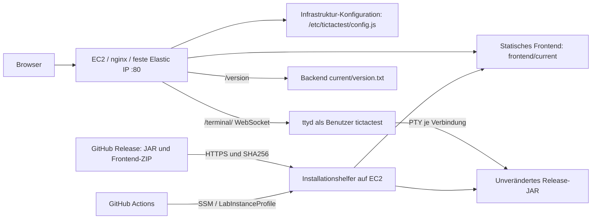

# TicTacTest: Infrastruktur und Release-Deployment

## Architektur und Entscheidung im Learner Lab



Das statische Frontend wird durch nginx auf EC2 öffentlich ausgeliefert. Ein eigener S3-Website-Bucket ist laut Auftrag eine Möglichkeit, keine Pflicht. Im konkreten Learner Lab ist `s3:GetBucketObjectLockConfiguration` per Service Control Policy gesperrt. Der AWS-Provider benötigt diese Abfrage beim Verwalten eines Buckets. Zwei zunächst erzeugte, anschließend nachweislich leere Buckets wurden deshalb wieder entfernt. Die Einschränkung wurde nicht durch andere IAM-Rechte oder eine Umgehung der gesperrten Operation verändert.

Die Alternative ist einfacher: nginx liefert unabhängig versionierte Frontend-Verzeichnisse aus; ttyd startet das unveränderte JAR. Die Instanz lädt die Artefakte direkt aus dem **öffentlichen** GitHub-Release. Ein privates Repository würde einen gesonderten autorisierten Artefakt-Transport benötigen; GitHub-Tokens werden nicht auf EC2 abgelegt. Das hier ausdrücklich gewünschte Repository ist öffentlich.

## Trennung der Lebenszyklen

OpenTofu erstellt Instanz, Elastic IP, Security Group, Runtime, systemd-Dienst, nginx und `config.js`. Es verwendet das vorhandene `LabInstanceProfile` als Datenquelle und erstellt keine IAM-Rollen oder Policies. Es lädt kein Spiel-JAR und kein Frontend-Release in user_data.

Das Deployment lädt nur veröffentlichte Assets, prüft SHA-256 und aktiviert die ausgewählten Komponenten. Kein Deploy-Workflow enthält `tofu apply`, `javac` oder einen Gradle-Build. Backend und Frontend haben getrennte atomare `current`-Symlinks.

## Infrastruktur lokal erstellen

Voraussetzungen: aktives Lab, gültiges AWS-Profil, Default-VPC mit öffentlichen Default-Subnetzen, `LabInstanceProfile`, AWS CLI, OpenTofu >=1.10, gh und Node 22+. Für den wiederholbaren AMI-Stand wird die ID einmal aufgelöst und lokal festgehalten:

```powershell
$env:AWS_PROFILE = 'lab' # oder der eingerichtete lokale Profilname
$env:AWS_DEFAULT_REGION = 'us-east-1'
aws sts get-caller-identity
aws ssm get-parameter --name /aws/service/ami-amazon-linux-latest/al2023-ami-kernel-default-x86_64 --query Parameter.Value --output text
Copy-Item infra/terraform.tfvars.example infra/terraform.tfvars
# ami_id in der lokalen Datei durch den tatsächlichen Wert ersetzen.
tofu -chdir=infra init
tofu -chdir=infra plan -out=cloud.tfplan
tofu -chdir=infra apply cloud.tfplan
tofu -chdir=infra output -json | Out-File -Encoding utf8 infra/outputs.json
```

tfvars, State, Pläne und Outputs bleiben außerhalb von Git. Die Provider-Lockdatei gehört dagegen ins Repository. Corretto und ttyd sind zusätzlich über feste Versionen/URLs und SHA256 gepinnt. Die Erstinstallation wird über cloud-init ausgeführt; bei Fehlern `/var/log/cloud-init-output.log`, `nginx -t` und `journalctl -u tictactest` prüfen. SSM muss vor dem ersten Deploy `Online` melden.

## Netzwerk, Dienst und Persistenz

Eingehend ist nur HTTP-Port 80 geöffnet: Frontend, eingebettetes Terminal, Health und Version. Die erlaubten Client-CIDRs sind variabel. Kein SSH-Port, kein öffentlicher ttyd-Port. Ausgehend ist HTTPS für SSM, GitHub und Runtime-/Paketdownloads zugelassen. IMDSv2 ist erforderlich. Der Dienst läuft als nicht privilegierter Benutzer ohne Login, startet direkt Java und keine Shell, begrenzt Verbindungen/JVM-Speicher und wird von systemd nach einem Absturz neu gestartet.

Nach Stop/Start bleibt die Elastic IP gleich. Die Release-Verzeichnisse und `current`-Symlinks liegen auf dem Root-EBS und bleiben erhalten; systemd startet dieselbe Backend-Version erneut. Das Frontend benötigt keinen eigenen Prozessneustart. Die vier erlaubten Verbindungen und der gruppenweite Speicherdeckel begrenzen Last, ersetzen aber keinen umfassenden Lasttest für eine 1-GB-Instanz.

Beim echten Learner-Lab-Sessionwechsel blieb die Instanz zunächst gestoppt. Falls das Lab sie beim Start einer neuen Session nicht startet, muss dieselbe EC2-Instanz einmal über die AWS-Konsole oder `aws ec2 start-instances --instance-ids INSTANCE_ID` gestartet werden. Anschließend kommen Dienste und gespeicherte App-Version automatisch zurück; kein `tofu apply` und kein erneuter App-Deploy sind dafür erforderlich. AWS-Credentials für die Pipeline müssen nach dem Sessionwechsel separat erneuert werden.

Outputs: `frontend_url`, `terminal_url`, `backend_version_url`, `instance_id`, `aws_region`. Diese Werte sind keine Secrets. Öffentlich ausgeliefert werden nur Frontend-Dateien und eine Konfiguration mit URLs, niemals Schlüssel, State, Pläne oder Betriebslogs. Das Lab verwendet HTTP ohne persönliche Daten; für dauerhaften produktiven Betrieb wären Domain, TLS und Zugriffsschutz vorzusehen.

## Manuelle Deployments A und B

Die manuellen Schritte verwenden denselben geprüften Deploy-Client, werden aber lokal aufgerufen. Er lädt Assets aus GitHub und gibt über SSM den Installationsauftrag. Keine Infrastruktur wird neu erstellt:

```bash
export AWS_PROFILE=lab
export AWS_REGION="$(tofu -chdir=infra output -raw aws_region)"
export INSTANCE_ID="$(tofu -chdir=infra output -raw instance_id)"
export BACKEND_VERSION_URL="$(tofu -chdir=infra output -raw backend_version_url)"
export FRONTEND_URL="$(tofu -chdir=infra output -raw frontend_url)"
node scripts/web/deploy.mjs v1.1.0 --force
curl --fail "$BACKEND_VERSION_URL"
curl --fail "$FRONTEND_URL/frontend-version.txt"
```

Nach Veröffentlichung von B denselben Aufruf mit dessen Tag wiederholen. Instanz-ID vorher/nachher vergleichen und `tofu -chdir=infra plan -detailed-exitcode` ausführen: Exit 0 bedeutet keine Änderungen, 2 bedeutet Änderungen, 1 einen Fehler. Tatsächliche Ergebnisse und Workflow-Links werden in [webapp-nachweise.md](webapp-nachweise.md) dokumentiert.

## Secrets-Konzept

| Wert | Ablage | Zweck |
| --- | --- | --- |
| AWS_ACCESS_KEY_ID, AWS_SECRET_ACCESS_KEY, AWS_SESSION_TOKEN | GitHub Environment `lab`, Secrets | Zusammengehörige temporäre Lab-Credentials |
| AWS_REGION, INSTANCE_ID, BACKEND_VERSION_URL, FRONTEND_URL | Environment `lab`, Variables | Nicht geheime OpenTofu-Outputs |
| AWS_DEPLOY_ENABLED=true | Repository Variable | Aktiviert automatische Release-Deployments nach vollständiger Einrichtung |
| GITHUB_TOKEN | Von Actions pro Job bereitgestellt | Lesen der Release-Assets; nicht auf der Instanz gespeichert |

```bash
node scripts/web/configure-github.mjs infra/outputs.json
node scripts/web/sync-lab-secrets.mjs lab
gh variable set AWS_DEPLOY_ENABLED --body true --repo raphaelhuerzele/450-tictactest-mvk
```

Der Refresh-Helfer prüft das lokale Profil, hält exportierte Credentials nur im Prozessspeicher und übergibt sie per stdin an gh. Nach jeder Lab-Session alle drei Werte gemeinsam erneuern. Ungültige Credentials lassen den Deploy-Client vor jeder Änderung mit verständlichem Fehler abbrechen. Danach denselben veröffentlichten Release manuell erneut deployen; kein Neubau ist nötig.

Der manuell startbare Workflow `deployment-auth-check.yml` prüft diesen Fehlerpfad, ohne gespeicherte Secrets zu verändern: Nur im Negativtest-Schritt ersetzt ein absichtlich ungültiger Test-Session-Token den echten Token. Der Deploy-Client muss vor jeder App-Änderung abbrechen. Danach prüft STS die ursprünglichen gültigen Secrets und der reguläre Deploy-Workflow installiert den angegebenen Release samt Browser-Abnahme. Das testet die Reaktion auf eine abgewiesene Sitzung; einen echten zeitlichen Ablauf oder die Erneuerung nach einem Lab-Sessionwechsel ersetzt es nicht.

Secrets sind in GitHub verschlüsselt gespeichert und nicht als Klartext auslesbar, berechtigte Workflows können sie aber verwenden. Zugriff auf Workflow-Code und Environment-Freigaben ist deshalb sicherheitsrelevant. Deploy läuft nicht für Fork-/PR-Ereignisse. Kein `set -x`, kein Environment-Dump; Logs nach jedem Lauf prüfen. GitHub-Masking ist keine Garantie gegen absichtlich transformierte Secretwerte. Bei einem Leak Session/Berechtigungen widerrufen, alle Werte erneuern, Läufe stoppen und CloudTrail/SSM sowie Logs und Historie auf Missbrauch prüfen. Löschen aus Git allein genügt nicht.

In einem Unternehmen wäre GitHub OIDC mit kurzlebiger, minimal berechtigter AWS-Rolle und einer auf Repository/Environment begrenzten Trust-Policy die bevorzugte Lösung. Im Learner Lab werden keine eigenen Rollen angelegt; dort gilt der dokumentierte Refresh temporärer Credentials. Die Instanz selbst nutzt für AWS-Zugriffe das Instance Profile/SSM und keine gespeicherten Access Keys.

## Release-basierte Änderungserkennung

Der Release-Workflow erzeugt und veröffentlicht zuerst alle Assets und ruft danach den wiederverwendbaren Deploy-Workflow explizit auf. Das vermeidet die GitHub-Falle, dass normale mit `GITHUB_TOKEN` erzeugte Release-Ereignisse keine weiteren Workflows starten. Ein normaler main-Push deployt nichts. Bis zur Einrichtung von AWS ist der automatische Deploy bewusst deaktiviert und wird als `skipped` angezeigt.

| Pfade | Deployment |
| --- | --- |
| src/main/**, Gradle-Wrapper, settings.gradle, gradle.properties | Backend |
| frontend/** | Frontend |
| build.gradle, Release-Workflow, Paketierungsskript | Beide, weil Artefakterzeugung betroffen sein kann |
| infra/**, ops/runtime/** | Infrastruktur, nur durch lokal geprüften OpenTofu-Plan |
| Deploy-Client/-Workflow, Tests und Dokumentation | Keine App-Änderung allein |

Verglichen werden der aktuelle und der vorherige veröffentlichte stabile Anwendungsrelease, nicht der vorherige Commit und nicht ein Dev-Container-Tag. So werden mehrere Commits zwischen Releases erfasst. Der erste Release deployt beide Komponenten. `paths`-Filter bilden diesen Release-Vergleich nicht ab und helfen bei Tag-Ereignissen nicht.

Backend: Der Client prüft die Release-Prüfsumme und übermittelt Tag/Repository/Digest per SSM. Der Server lädt dasselbe JAR über HTTPS und prüft den Digest nochmals. Vor dem Umschalten führt er eine vollständige Smoke-Partie aus. Dann atomarer Symlink-Wechsel, Dienstneustart und Health-/Versionskontrolle. Bei Aktivierungsfehler wird die letzte Version wiederhergestellt, der Job bleibt rot. Die externe Versionsabfrage muss danach exakt den gewünschten Tag ohne v melden.

Frontend: Derselbe Ablauf mit dem Release-ZIP, Pfadvalidierung und Versionsdatei. Ein neues Release-Verzeichnis ersetzt die aktive Sicht atomar; Dateien, die im neuen Archiv fehlen, werden nicht mehr ausgeliefert. Alte Verzeichnisse bleiben für Diagnose/Rollback liegen. `/config.js` ist eine separate nginx-Alias-Datei unter `/etc/tictactest` und kann vom Frontend-Archiv nicht überschrieben oder entfernt werden. Kein Backend-Neustart bei Frontend-only.

Globales GitHub-`concurrency` serialisiert alle automatischen und manuellen Deployments; `flock` schützt zusätzlich die Server-Helfer. Das Warten auf SSM ist auf 90 Versuche mit zwei Sekunden Pause begrenzt, die HTTP-Prüfung auf 30 Versuche mit je vier Sekunden Timeout und zwei Sekunden Pause. Bei Ablauf scheitert der Job. Backend-Neustarts beenden laufende Spiele; Blue/Green mit Draining vorhandener WebSockets wäre eine mögliche spätere Zero-Downtime-Lösung.

Nach dem Deployment öffnet ein echter Chrome auf dem GitHub-Runner die öffentliche Web-Konsole. Playwright Core 1.64.1 prüft eine vollständige Partie, zwei getrennte Tabs, ungültige Eingabe und Neustart. JSON-Protokoll und Screenshot werden zusammen mit der Deployment-Auswahl als Workflow-Artefakt gespeichert. Unterschiedliche Frontend-/Backend-Versionen sind bei selektiven Releases erlaubt; die exakte Zielversion jeder deployten Komponente wurde bereits vorher per HTTP geprüft.

## Rollback, Fehler und Wiederaufbau

```bash
gh workflow run deploy.yml --ref main -f release_tag=v1.1.0
```

Manueller Dispatch erzwingt beide Komponenten einer veröffentlichten Web-Version. Die ursprünglichen v1.0.x-Releases besitzen noch kein Frontend-ZIP und erfüllen diesen Artefaktvertrag nicht. Ein kaputtes JAR scheitert vor dem Umschalten; eine HTTP-Versionsabweichung macht den Workflow rot. Scheitert ein Frontend-Deploy nach erfolgreichem Backend-Deploy, können die Versionen gemischt sein; dann beide Komponenten des letzten guten Releases erneut installieren.

Bei `user_data_replace_on_change=true` zeigt eine Erstinstallationsänderung einen Instanzersatz. Die separate Elastic IP bleibt erhalten, der alte Root-EBS-Inhalt jedoch nicht; anschließend gewünschte Assets erneut deployen. Ein gewöhnlicher App-Release ändert kein user_data. Nach ausdrücklich gewünschtem destroy/apply ändern sich Instanz-ID und meist IP: Outputs/Environment-Variables aktualisieren, SSM abwarten und dieselben Release-Assets per Dispatch installieren. State und Schlüssel bleiben lokal. Session-Ende sowie Destroy werden nicht unangekündigt zu Testzwecken ausgeführt.

## Reflexion und Promotion

```text
Backend: Commit → CI → main → Release-Tag → geprüftes JAR → SSM → Download/SHA → Dienstwechsel → HTTP-Prüfung
Frontend: Commit → CI → main → Release-Tag → Frontend-ZIP → SSM → Download/SHA → Symlink-Wechsel → HTTP-Prüfung
```

Automatisch sind Tests, Build, Artefaktveröffentlichung, Änderungserkennung und ausgewählte Deployments samt Prüfungen. Manuell bleiben Infrastrukturplan/-apply, Lab-Start, Credential-Refresh und bewusster Rollback.

Für dev/staging/prod würde derselbe Infrastrukturcode mit getrennten States, Instanzen, Adressen und GitHub Environments verwendet. Gleich bleiben Artefaktvertrag und Architektur, unterschiedlich sind Größe, Region, Domain/TLS, Zugang und Freigaben. Ein Modul mit je eigenen Variablen/State-Schlüsseln vermeidet dreifache Codekopien.

Promotion reicht dieselben unveränderten Artefakte weiter, statt pro Umgebung neu zu bauen. Dev kann nach Release automatisch folgen; staging nach Integrations-/Browser-Tests; prod nach weiteren fachlichen/Sicherheitsprüfungen und manueller Freigabe durch Required Reviewers einer GitHub Environment. Die Produktionsrolle wird auf dieses Environment begrenzt.

Sind Umgebungen unterschiedlich aktuell, muss die Änderungserkennung deren tatsächlich deployte Backend-/Frontend-Tags separat speichern und gegen das Ziel vergleichen. Unser globaler vorheriger Release setzt eine fortlaufend aktualisierte Lab-Umgebung voraus. Nach einem ausgelassenen/fehlgeschlagenen Deployment, Rollback oder Wiederaufbau beide Komponenten gezielt mit `--force` installieren. Eine persistierte Komponenten-Historie je Umgebung wäre die nächste Ausbaustufe.

Quellen: [GitHub Workflow-Ereignisse](https://docs.github.com/en/actions/how-tos/write-workflows/choose-when-workflows-run/trigger-a-workflow), [OIDC mit AWS](https://docs.github.com/en/actions/how-tos/secure-your-work/security-harden-deployments/oidc-in-aws), [SSM-Status](https://docs.aws.amazon.com/systems-manager/latest/userguide/monitor-commands.html).
