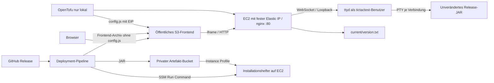

# Aufträge 2 und 3 – Infrastruktur und Release-Deployment

## Komponenten und Lebenszyklen



OpenTofu provisioniert AWS-Ressourcen, Java/ttyd, nginx, Dienst und Konfiguration. Es lädt **kein Spiel-JAR** herunter. Das Deployment installiert ausschließlich veröffentlichte Artefakte und verändert keine Infrastruktur. Insbesondere gibt es in keinem Deployment-Workflow `tofu apply` oder einen Java-Build.

Gewählter Bezug: GitHub Actions lädt Release-Assets mit seinem kurzlebigen GitHub-Token, prüft SHA-256, kopiert das JAR in den privaten S3-Bucket und ruft den privilegierten Installationshelfer über SSM auf. Die Instanz benötigt dank `LabInstanceProfile` keinen GitHub-Token und keine statischen AWS-Keys. Dies funktioniert auch bei einem privaten GitHub-Repository. SSH wäre einfacher zum direkten Kopieren, erfordert aber SSH-Schlüsselverwaltung und eine eingehende Netzwerkregel für wechselnde Runner-Adressen. SSM benötigt stattdessen einen aktiven Agent, Instance Profile und ausgehendes HTTPS.

## Infrastruktur erstellen

Voraussetzungen: aktive Learner-Lab-Session, gültiges lokal konfiguriertes AWS-Profil, GitHub CLI, OpenTofu >=1.10, vorhandenes Default-VPC mit öffentlichen Default-Subnetzen und `LabInstanceProfile`. Es werden keine IAM-Rollen oder Policies angelegt. Das Lab-Profil muss SSM sowie S3 erlauben. Die AWS-Region muss mit dem Lab übereinstimmen.

PowerShell:

```powershell
$env:AWS_PROFILE = 'lab'
$env:AWS_DEFAULT_REGION = 'us-east-1'
aws sts get-caller-identity
# Genau einmal auflösen und den AMI-Wert in der lokalen tfvars-Datei festhalten:
aws ssm get-parameter --name /aws/service/ami-amazon-linux-latest/al2023-ami-kernel-default-x86_64 --query Parameter.Value --output text
Copy-Item infra/terraform.tfvars.example infra/terraform.tfvars
# ami_id in infra/terraform.tfvars durch den erhaltenen Wert ersetzen.
tofu -chdir=infra init
tofu -chdir=infra plan -out=plan.tfplan
tofu -chdir=infra apply plan.tfplan
tofu -chdir=infra output -json | Out-File -Encoding utf8 infra/outputs.json
```

`terraform.tfvars`, State, Pläne und `outputs.json` bleiben lokal und werden ignoriert. Die Provider-Lockdatei ist dagegen versioniert. Kein `latest`-AMI-Lookup wird bei jedem Plan erneut ausgewertet. AL2023-Pakete stammen aus dem zum AMI gehörenden Repository-Stand; Corretto und ttyd sind zusätzlich mit festen Downloadadressen und SHA-256 gepinnt.

Die erste Provisionierung benötigt Zeit. Vor dem Deploy muss SSM `Online` melden:

```powershell
$o = Get-Content -Raw infra/outputs.json | ConvertFrom-Json
aws ssm describe-instance-information --filters "Key=InstanceIds,Values=$($o.instance_id.value)" --query 'InstanceInformationList[].PingStatus' --output text
```

Bei Fehlern auf der Instanz `/var/log/cloud-init-output.log`, `journalctl -u tictactest` und `nginx -t` prüfen. S3 Static Website benötigt eine öffentliche Read-Policy; ein übergeordnetes Account-Public-Access-Block kann dies im Lab verhindern. In diesem Fall muss die Lab-Freigabe geklärt oder ein anderes erlaubtes Frontend-Hosting gewählt werden; keine AWS-Schutzvorgabe stillschweigend umgehen.

## Netzwerk und Persistenz

Eingehend wird nur TCP 80 für die HTTP-Konsole, Versionsabfrage und Health-URL freigegeben; die CIDRs sind konfigurierbar. Kein SSH-Port, kein öffentlicher ttyd-Port. Ausgehend ist HTTPS für SSM, S3, Paket- und Runtime-Downloads zugelassen. DNS zur VPC-Auflösung und EC2-Metadaten sind spezielle AWS-Link-Local-Dienste; IMDSv2 ist erforderlich.

Die Elastic IP bleibt bei Stop/Start gleich. Das aktuelle JAR liegt auf dem persistenten Root-EBS unter `/opt/tictactest/releases/<tag>-<sha>/game.jar`; der atomare Symlink `/opt/tictactest/current` bestimmt die Version. systemd aktiviert dieselbe Datei nach einem Reboot erneut. Der Dienst läuft als Benutzer ohne Login, startet nur Java, begrenzt Ressourcen und wird bei Absturz neu gestartet.

Outputs: `frontend_url`, `terminal_url`, `backend_version_url`, `instance_id`, `frontend_bucket`, `artifact_bucket`, `aws_region`. Sie sind keine Zugangsdaten, aber Infrastruktur-Metadaten. Der öffentliche Frontend-Bucket enthält ausschließlich HTML/CSS/JS und Frontend-Version – niemals AWS-Keys, SSH-Schlüssel, State, Pläne, private Konfiguration oder Logs.

## Zweimal von Hand deployen (vor Automatisierung)

Die folgenden Befehle starten den Deploy-Client bewusst lokal. `--force` installiert beide Komponenten einer bereits veröffentlichten Version. Node 22+, Python 3, AWS CLI und gh sind erforderlich; unter Windows ist dafür Ubuntu/WSL oder eine funktionierende Python-3-Installation nötig. Keine neue Infrastruktur wird erstellt.

In Bash nach `tofu output -json > infra/outputs.json`:

```bash
export AWS_PROFILE=lab
export AWS_REGION="$(tofu -chdir=infra output -raw aws_region)"
export INSTANCE_ID="$(tofu -chdir=infra output -raw instance_id)"
export ARTIFACT_BUCKET="$(tofu -chdir=infra output -raw artifact_bucket)"
export FRONTEND_BUCKET="$(tofu -chdir=infra output -raw frontend_bucket)"
export BACKEND_VERSION_URL="$(tofu -chdir=infra output -raw backend_version_url)"
export FRONTEND_URL="$(tofu -chdir=infra output -raw frontend_url)"
node scripts/web/deploy.mjs v1.1.0 --force
curl --fail "$BACKEND_VERSION_URL"
curl --fail "$FRONTEND_URL/frontend-version.txt"
```

Release A im Browser öffnen und spielen. Danach eine sichtbare Frontend-Änderung und Changelog für B committen, nach main pushen und einen neuen stabilen Tag, beispielsweise `v1.1.1`, pushen. Erst nach erfolgreichem Release-Workflow B installieren:

```bash
node scripts/web/deploy.mjs v1.1.1 --force
tofu -chdir=infra plan -detailed-exitcode
```

Erwartet: Exitcode 0, keine Infrastrukturänderung. Exitcode 2 bedeutet Änderungen, 1 einen Fehler. Instanz-ID und Elastic IP vor und nach dem Deployment vergleichen. Die tatsächlichen Ergebnisse und Links stehen separat in `docs/webapp-nachweise.md`; die Befehle allein sind kein durchgeführter Nachweis.

## Secrets-Konzept und Einrichtung von GitHub

| Wert | Ablage | Grund |
| --- | --- | --- |
| AWS_ACCESS_KEY_ID, AWS_SECRET_ACCESS_KEY, AWS_SESSION_TOKEN | GitHub Environment `lab`, Secrets | Die drei zusammengehörigen temporären Learner-Lab-Credentials |
| AWS_REGION, INSTANCE_ID, ARTIFACT_BUCKET, FRONTEND_BUCKET, BACKEND_VERSION_URL, FRONTEND_URL | GitHub Environment `lab`, Variables | Nicht geheime Infrastruktur-Outputs |
| AWS_DEPLOY_ENABLED=true | Repository Variable | Schaltet automatisches Deployment erst nach vollständiger Einrichtung ein |
| GITHUB_TOKEN | Von Actions pro Job bereitgestellt | Read-Zugriff auf Release-Assets; keine manuelle PAT-Datei auf EC2 |

Nicht geheime Werte und die Environment lassen sich aus Outputs einrichten. PowerShell-`Out-File` kann einen UTF-8-BOM erzeugen; der Konfigurationshelfer akzeptiert diesen:

```bash
node scripts/web/configure-github.mjs infra/outputs.json
node scripts/web/sync-lab-secrets.mjs lab
gh variable set AWS_DEPLOY_ENABLED --body true --repo raphaelhuerzele/450-tictactest-mvk
```

`sync-lab-secrets.mjs` prüft zuerst das lokale Profil, exportiert die temporären Credentials ausschließlich in Prozessspeicher und übergibt sie per stdin an `gh secret set`. Keine Schlüsselwerte werden in Argumente, Dateien oder Logs geschrieben. Nach jeder neuen Lab-Session alle drei Werte gemeinsam erneuern. Secrets werden verschlüsselt gespeichert und sind nicht über die GitHub-Oberfläche auslesbar; berechtigte Workflow-Ausführungen können sie aber nutzen. Wer Workflow-Code ändern oder geschützte Deployments freigeben darf, hat deshalb sicherheitsrelevanten Einfluss.

Keine Secrets in PR-Workflows oder Forks einsetzen. Deploy ist ausschließlich Release-Aufruf oder manueller Dispatch, verwendet eine geschützte Environment und keinen `pull_request_target`-Checkout. GitHub maskiert bekannte Secretwerte, aber das ist kein Schutz für absichtlich transformierte Werte. Kein `set -x`, kein Ausgabe-Dump von Umgebungsvariablen; Logs nach jedem Lauf kontrollieren.

Die Lab-Credentials laufen mit der Session ab. Der Deploy-Client prüft STS vor jeder Ressourcenänderung. Bei ungültigen Credentials endet der Job verständlich mit Fehler; das vorhandene Spiel bleibt bestehen. Nach Refresh denselben veröffentlichten Release manuell erneut deployen. Ein fehlgeschlagener Deploy erfordert keinen neuen Build oder Tag.

Bei einem Leak: betroffene Berechtigung/Session widerrufen bzw. Lab neu starten, alle drei Secrets ersetzen, Workflow stoppen und CloudTrail/SSM/S3 sowie Logs und Git-Historie auf Missbrauch prüfen. Secret aus Git löschen allein reicht nicht. Der Schaden kann S3-Manipulation oder privilegierte Befehle über SSM umfassen. In einem Unternehmen: GitHub OIDC mit kurzlebiger AWS-Rolle, minimalen Berechtigungen und Trust-Policy für genau Repository und Environment statt regelmäßig kopierter Keys. Im Learner Lab sind eigene IAM-Rollen nicht erlaubt, daher wird diese Strategie nur beschrieben.

## Automatisches Deployment und Pfadregeln

Der Release-Workflow erzeugt zuerst alle geprüften Assets und veröffentlicht den Release. Anschließend ruft er `deploy.yml` als wiederverwendbaren Workflow auf. Ein nur auf `release: published` lauschender Workflow wäre hier unzuverlässig: mit `GITHUB_TOKEN` erzeugte Ereignisse starten regulär keine weiteren Workflows. Der explizite Aufruf vermeidet diese Falle. Solange AWS noch nicht eingerichtet ist, ist automatisches Deployment deaktiviert; dies wird nicht als erfolgreicher Cloud-Deploy ausgegeben.

| Pfad | Wirkung |
| --- | --- |
| src/main/**, Gradle-Wrapper, settings.gradle, gradle.properties | Backend |
| frontend/** | Frontend |
| build.gradle, Release-Workflow, package-assets-Skript | Beide, da Artefakte/Verpackung betroffen sein können |
| infra/**, ops/runtime/** | Infrastruktur: nur durch lokalen geprüften OpenTofu-Plan ändern, kein automatischer App-Deploy |
| Deploy-Workflow/-Client | Steuerung des Deployments; keine Spiel-/Frontend-Änderung allein |
| Tests, Dokumentation | Kein App-Deployment |

Verglichen wird mit dem vorherigen veröffentlichten stabilen Anwendungsrelease nach Veröffentlichungszeit, nicht mit dem vorherigen Commit oder einem Dev-Container-Tag. So gehen mehrere Commits zwischen Releases nicht verloren. Beim ersten Anwendungsrelease werden beide Komponenten installiert. Das erste Web-Release enthält sowohl Frontend- als auch Backend-/Packaging-Änderungen. Ein `paths`-Filter hilft bei Tag-Ereignissen nicht und bildet außerdem keinen Release-zu-Release-Vergleich ab.

Backend: JAR herunterladen, SHA prüfen, S3-Upload, SSM-Aufruf. Der Server führt vor dem Wechsel eine vollständige Smoke-Partie mit dem neuen JAR aus. Erst dann werden Symlink und Dienst gewechselt. Bei Aktivierungsfehler wird die vorherige Version wiederhergestellt, der Job bleibt rot. Anschließend kontrolliert der Client die externe Versions-URL. Das Warten ist begrenzt: SSM bis 180 Sekunden Client-Wartezeit, danach maximal 30 HTTP-Versuche mit je vier Sekunden Timeout und zwei Sekunden Pause. Ein Versionsmismatch beendet den Workflow mit Fehler.

Frontend: nur das Release-ZIP entpacken und prüfen, `aws s3 sync --delete --exclude config.js`, dann `frontend-version.txt` per HTTP kontrollieren. Alte Dateien werden entfernt, die Infrastruktur-Konfiguration bleibt von Upload und Löschung ausgeschlossen. Fehlte `config.js`, könnte die Seite kein Terminal mehr finden. Alte Backend-/Frontend-Versionen dürfen bei selektiven Deployments absichtlich unterschiedlich sein.

Ein globales `concurrency`-Schloss serialisiert automatische und manuelle Deployments. Ein zusätzliches `flock` schützt den Backend-Helper gegen gleichzeitige manuelle SSM-Aufrufe. Beim Dienstneustart werden laufende Partien beendet. Ein echter Zero-Downtime-Ansatz wäre Blue/Green mit separater neuer ttyd-Instanz und Draining vorhandener WebSocket-Verbindungen; das ist hier nur ein Ausblick.

## Rollback und Wiederaufbau

```bash
gh workflow run deploy.yml --ref main -f release_tag=v1.1.0
```

Manueller Dispatch erzwingt beide Komponenten, unabhängig vom Pfadvergleich. Der gewählte Release muss alle Web-Assets besitzen; die älteren Releases v1.0.0/v1.0.1 haben noch kein Frontend und erfüllen diesen neuen Vertrag nicht. Ein ungültiges JAR scheitert vor dem Umschalten, die alte Version bleibt aktiv. Scheitert erst das Frontend nach einem erfolgreichen Backend-Deploy, kann ein gemischter Stand entstehen; dann beide Komponenten des letzten guten Releases manuell wiederherstellen.

Nach echtem `destroy/apply` ändern sich mindestens Bucketnamen, Instanz-ID und meist Elastic IP. Neue Outputs nach GitHub übertragen, Lab-Secrets prüfen, Cloud-init/SSM abwarten und die gewünschte Web-Version per Dispatch/`--force` installieren. State und Secrets niemals in das Frontend kopieren. Buckets sind absichtlich nicht `force_destroy`: vor einem ausdrücklich gewünschten Destroy müssen gespeicherte Artefakte gesichert und die Buckets bewusst geleert werden.

`user_data_replace_on_change=true` macht Änderungen an der Erstinstallation sichtbar: `tofu plan` zeigt Instanzersatz. Die separate Elastic-IP-Ressource bleibt ohne Destroy erhalten und wird neu zugeordnet; der Inhalt des alten Root-EBS und damit die laufende App-Version geht bei Ersatz verloren. Erneutes Deployment ist dann nötig. Eine neue JAR-Version verändert dagegen kein user_data und benötigt keinen Plan/Apply. Für häufige Runtime-Konfigurationsänderungen wäre später Konfigurationsmanagement ohne Instanzersatz sinnvoll.

## Experiment- und Release-Nachweise

In `docs/webapp-nachweise.md` sind tatsächliche Tests von noch ausstehenden AWS-Experimenten getrennt. Nach gültiger Lab-Anmeldung müssen durchgeführt werden: A/B-Deployment, Session-Neustart, user_data-Änderung mit Plan, ausdrücklich freigegebenes Destroy/Apply, Rollback und kaputter Release. Für jedes Experiment Datum, Instanz-ID, URL, vorherige/nachherige Version und Workflow-Link erfassen. Destroy und das Beenden der Lab-Session werden niemals allein zum Erzeugen eines vermeintlichen Nachweises automatisch ausgeführt.

## Reflexion: Umgebungen und Promotion

```text
Backend: Commit → CI → main → Release-Tag → geprüftes JAR → S3 → SSM → Dienstwechsel → HTTP-Prüfung
Frontend: Commit → CI → main → Release-Tag → Frontend-ZIP → S3-Sync (config.js bleibt) → HTTP-Prüfung
```

Automatisch: Builds, Tests, Paketierung, veröffentlichte Releases, ausgewählte Deployments und Versionsprüfungen. Manuell: Infrastrukturplan/-apply, AMI-/Runtime-Änderungen, Lab-Start und Secret-Refresh sowie gewollter Rollback.

Für dev/staging/prod würde derselbe Infrastrukturcode mit je eigenen Variablen, getrennten States, Buckets, Instanzen und Environments genutzt. Gleich bleiben Architektur und Artefaktvertrag; unterschiedlich sind Region/Größe, Domain/TLS, Zugriff, Secrets und Freigaben. Kein dreifaches Kopieren des gesamten Codes, sondern eine wiederverwendbare Modulstruktur und getrennte Backend-State-Schlüssel.

Promotion reicht **dieselben geprüften Artefakte** von dev nach staging und prod weiter; keine Neubauten pro Umgebung. Dev kann auf Release automatisch folgen, staging nach erfolgreichen Integrations-/Browser-Tests, prod erst nach Freigabe durch Required Reviewers in einer GitHub Environment. Prod-Berechtigungen sind auf dieses Environment begrenzt. Ein Schutzgatter sollte fachliche Smoke-/Integrationstests, Sicherheitsprüfungen und die Versionskontrolle umfassen.

Bei unterschiedlich weit zurückliegenden Umgebungen reicht der globale vorherige Release als Vergleich nicht: pro Umgebung müssen die tatsächlich deployten Backend- und Frontend-Tags gespeichert und gegen das Ziel verglichen werden. Unser einfacher Vergleich gilt für eine durchgehend aktualisierte Lab-Umgebung; bei übersprungenem/fehlgeschlagenem Deploy, Rollback oder Wiederaufbau beide Komponenten gezielt mit `--force` wiederherstellen. Künftig wäre eine pro Umgebung persistierte Komponenten-Historie die robustere Automatik.

Quellen: [GitHub Workflow-Ereignisse](https://docs.github.com/en/actions/how-tos/write-workflows/choose-when-workflows-run/trigger-a-workflow), [OIDC mit AWS](https://docs.github.com/en/actions/how-tos/secure-your-work/security-harden-deployments/oidc-in-aws), [S3 sync und Exclude/Delete](https://docs.aws.amazon.com/cli/latest/reference/s3/sync.html), [SSM Command Status](https://docs.aws.amazon.com/systems-manager/latest/userguide/monitor-commands.html).
